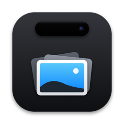

<p align="center">
  
</p>

<h1 align="center">Luoto</h1>

<p align="center">
  <b>A notch app that stays out of the way.</b><br>
  Idle: 0.0% CPU. Music playing: 0.5%. Pointer moving: 0.4%.<br>
  Free, open source, and silent on the network until you ask for something.
</p>

<p align="center">
  <a href="LICENSE"></a>
  
  
  <a href="README.ru.md">Русский</a>
</p>

Luoto turns the notch of a MacBook into a small place for your clipboard, your screenshots and your music. It is a fork of [Atoll](https://github.com/Ebullioscopic/Atoll).

The numbers above are average CPU use of the Luoto process, measured with `top` on a MacBook. Idle means no keyboard or mouse input on the Mac; typing in other apps was not measured. The music number leaves out the small helper (a `perl` process) that reads Now Playing and runs only while sound is playing. To measure it yourself, start Luoto and run [`scripts/perf/measure.sh`](scripts/perf/measure.sh) with a label (`idle`, `music`, `mouse`) and a length in seconds (3 minutes at most):

```bash
scripts/perf/measure.sh idle 120
```

## What it does

**Screenshots in batches.** Take screenshots as usual (⇧⌘3, ⇧⌘4, ⇧⌘5). They collect into one batch at the notch. **Paste into Claude · 3** (or any app you were working in) drops the whole batch. You can pick which shots go, drag the batch anywhere, mark a shot up, or AirDrop it. Optionally, shots taken straight to the clipboard (⌃⇧⌘3/4) join the batch too. Those live in a temporary folder and are deleted within a day.

**Clipboard history.** Everything you copy becomes a card, with search, filters and pins. Paste again in one click.

**Now playing.** Artwork, title and transport controls from Spotify, Music or a browser tab. Shuffle, repeat, volume, output and lyrics show while the pointer is over the player. **Next** shows your upcoming events beside it. A short video (under 5 minutes) without track details does not take the player over. Swipe the closed notch to change tracks.

**Keep working with the lid closed.** Turn on **With the lid closed** in Keep Awake, and builds, downloads and AI agents go on under a closed lid, on battery and with no display. The first time asks for your password once. It stops by itself at the battery level you choose (20% unless you pick 10, 30 or 50%) or if the Mac overheats. Don't put the Mac in a bag while it runs.

**Also in the notch**
- Volume, brightness and keyboard backlight indicators in place of the system ones.
- Calendar events and reminders; a timer and Keep Awake with a duration, which can also keep the Mac working with the lid closed (see below).
- A shelf for files you drop on the notch; AirDrop and LocalSend sharing.
- A colour picker that copies the colour, a notes tab (with optional sync to Apple Notes), a terminal.
- Indicators for Caps Lock, Focus, screen recording, microphone and camera use, downloads in progress, Bluetooth connections and battery.
- Lock screen widgets: music, weather, calendar event, reminders, timer, Focus.
- Per-app volume and a live waveform of the music.
- Stats (CPU, memory, disk, network, GPU) and a usage monitor for Claude, Codex and Cursor.
- Screen Assistant: snip a part of the screen and ask an AI service about it.
- Third-party extensions, a compact layout, hotkeys, English and Russian.
- While your screen is shared or recorded, the clipboard and screenshots show only their titles.

Almost everything is a switch in Settings.

## Install

Requirements: **macOS 14.6+, tested on 26.** A Mac with Apple silicon (M1 or newer). Made for MacBooks with a notch; on other screens Luoto shows a floating island (tested only on a notched MacBook Pro).

1. Download `Luoto-<version>.dmg` and `Luoto-<version>.dmg.sha256` from [Releases](../../releases).
2. Check the download. Run this in the folder with both files; it must print `OK`:
   ```bash
   shasum -a 256 -c Luoto-<version>.dmg.sha256
   ```
3. Open the DMG and drag **Luoto** to Applications.
4. Open Luoto. macOS refuses the first launch (see below).
5. Follow the onboarding. It asks one thing about the network (updates) and offers Accessibility; both can be skipped.

### The first launch: Open Anyway

Luoto is **not notarized**. Notarization needs Apple's paid developer account, and Luoto is free. So macOS says it cannot verify the app and blocks it the first time. This happens once for each copy you download. To open it:

1. Try to open Luoto, then close the warning.
2. Open **System Settings → Privacy & Security** and scroll down to the Security section.
3. Find the line about Luoto and click **Open Anyway**.
4. macOS may ask for your password or Touch ID. Confirm, then click **Open** in the next dialog.

Download Luoto only from this repository's Releases and check the SHA-256.

## Permissions

**Nothing asks for a permission when Luoto starts.** A permission is asked when you turn on the feature that needs it, or the first time you use it. The clipboard history and the screenshot batches are on from the first launch; the screenshot folder is looked at when you press Continue in onboarding with Screenshots on, or when you open the Screenshots tab. Refuse anything and that feature stays quiet; the rest keeps working.

| Permission | What it is for | When Luoto asks | Without it |
|---|---|---|---|
| Accessibility (no key; macOS's own dialog) | Press ⌘V for you to paste in one click; replace the system volume, brightness and backlight indicators | First one-click paste (once), the Allow Access button in onboarding or Settings | Paste only copies, and Luoto says "press ⌘V". The system indicators stay as they are |
| Automation: Spotify, Music | Show the player and control it | The first time you click a player control or choose the source | No player controls for that app |
| Automation: Notes | Sync notes with Apple Notes | When you turn on Notes sync | Sync reports an error; local notes are unaffected |
| Automation: System Events | Stop a screen recording from the Stop button | The first click on Stop | Luoto tries other ways to stop it, and reports if it cannot |
| Bluetooth | Battery level of Bluetooth headphones | When you turn on the Bluetooth battery switch (Devices, or the lock screen) | A toast with the device name, no battery |
| Calendars | Next events in the island and on the lock screen | The Allow Access button in the island, or the lock screen calendar switch | No events |
| Reminders | Reminders in the island and on the lock screen | Same button, or the reminder switches | No reminders |
| Desktop folder | Look at your screenshot folder (the Desktop by default) and gather new screenshots | Continue in onboarding with Screenshots on, or the Screenshots tab | Screenshots taken to the clipboard still collect; folder screenshots do not |
| Documents folder | Same, only if your screenshot folder is in Documents | The same moment, for that folder | Same |
| Downloads folder | Show downloads in progress | When you turn on download detection | No download indicator |
| Location | Weather on the lock screen | When you turn on the weather widget | Weather without exact coordinates |
| Apple Music | Animated artwork on the lock screen | When you turn on animated artwork | No animated artwork |
| Audio capture | The live waveform and per-app volume. Audio is processed live and never recorded or saved | When you turn on the waveform, or on the first per-app volume change | No waveform; per-app volume shows a notice |
| Screen Recording | Screen Assistant: snip part of the screen | When you press the snip button | The snip does nothing |
| Local Network | Find nearby devices for LocalSend | When you turn on LocalSend | No LocalSend |
| Full Disk Access (optional, no key, no dialog) | Read custom Focus names | Never; you add Luoto by hand in Privacy & Security | Focus is shown, but under the name "Focus" |
| Keychain items of other apps | The usage monitor reads sign-in tokens of Claude, Codex, Cursor and others to ask their usage | When you turn on the usage monitor; macOS asks for each item | No usage numbers |
| Login Items (no dialog) | Start Luoto at login | When you turn on launch at login in Settings → General | Luoto does not start at login |
| Administrator password and a background item (macOS's own dialog; Luoto never sees the password) | Keep the Mac awake with the lid closed, through a small helper that acts only during a session | Once, when you turn on **With the lid closed**, and again only if a new version changes the helper | The Mac sleeps as usual when you close the lid |

Reset all of them at any time:

```bash
tccutil reset All io.github.amidamaru940.luoto
```

## Network

**By default nothing goes to the network.** Luoto has no analytics.

**Updates.** Onboarding asks once, with two equal buttons: *Check once a day* and *Don't check*. Nothing is sent before you press one. After "yes" Luoto makes one request a day to GitHub, which sees your IP address and the Luoto version. No system profile is sent, and nothing installs without you. *Check for Updates…* in Settings works at any time. You can change the choice in Settings.

**Features that use the network, only when you turn them on**

| Feature | What leaves your Mac, and where |
|---|---|
| Spotify and YouTube Music covers | once you let Luoto control Spotify (Automation) or choose YouTube Music as the source, the cover picture is downloaded from the address the player gives. That server sees your IP address. There is no separate switch |
| Lock screen weather | approximate location or your IP address → wttr.in, open-meteo.com |
| Lyrics | track title and artist → lrclib.net, music.163.com |
| Explicit badges and artist names | track title and artist → itunes.apple.com; track id → open.spotify.com |
| Apple Music animated artwork | catalog request → api.music.apple.com |
| Spotify like button and Canvas | your Spotify sign-in → accounts.spotify.com, api.spotify.com and related Spotify addresses, plus a file from a third-party project, raw.githubusercontent.com/xyloflake/spot-secrets-go |
| Screen Assistant | **screenshots and text** → the AI service you pick (Gemini, OpenAI, Groq, Anthropic), or a local Ollama on this Mac |
| Usage monitor (Claude, Codex, Cursor, Antigravity) | tokens read from your keychain → those services; model prices from raw.githubusercontent.com |
| LocalSend | listens on your **local network** (TCP 53317, plus multicast) while it is on, not only on 127.0.0.1 |
| Extensions | a port on 127.0.0.1 for other apps on this Mac |

Cider and YouTube Music controls talk to those players on this Mac (localhost). Covers are the exception, as the table says.

Every address in the source is in [`tests/network_allowlist.txt`](tests/network_allowlist.txt), with the feature and the setting that turns it on. The test [`tests/test_network_allowlist.py`](tests/test_network_allowlist.py) fails if a new address appears without an entry. Cover addresses come from the players while Luoto runs, so they are not in that list. Run it with `python3 -m unittest discover tests -p test_network_allowlist.py`.

## Privacy

- Clipboard history lives in memory only, unless you turn on saving to disk.
- Items marked concealed (password managers do this) and copies from apps you exclude are never recorded.
- By default, entries you have not pinned expire after 24 hours (you can change this in Settings), and one-time codes after 2 minutes.
- Screenshots taken to the clipboard are kept as files in a temporary folder and deleted within a day.

## FAQ

**Why "Open Anyway"?** Luoto is not notarized: that needs Apple's paid account. The app is signed, the source is here, and the SHA-256 lets you check the download. See [SECURITY.md](SECURITY.md).

**Why Accessibility?** To press ⌘V in the app you were working in (one-click paste), and to catch the volume and brightness keys for Luoto's own indicators. The same access also lets Luoto read a few things from other apps: where the front app's menu titles sit (so the island fits beside them), whether a window is in full screen, the Clock timer in the menu bar, and Tidal's menus if Tidal is your source. With this access Luoto does not read what is on your screen or record what you type. While idle, its clipboard check waits for the next key or pointer event, and it ignores which key that was. Without it, paste copies and you press ⌘V yourself.

**Does it drain the battery?** See the numbers at the top and measure on your own Mac with `scripts/perf/measure.sh`. The waveform, per-app volume, stats, download detection and the usage monitor run only when you turn them on.

**What does "With the lid closed" do?** While a Keep Awake session runs, a small helper turns system sleep off, so closing the lid does not stop anything. Luoto says you can close the lid only after reading back from the system that this took effect. The session ends by itself at the level you choose when on battery power (20% unless you pick 10, 30 or 50%), or if the Mac overheats, and a Mac with its lid closed then sleeps. macOS's own low-battery and heat sleep does not work while sleep is off, which is why the helper checks both, and why the Mac should not go in a bag. If Luoto quits, crashes or hangs, the helper turns sleep back on within about a minute. The built-in microphone and camera don't work under a closed lid, and Sleep in the Apple menu does nothing during a session. In System Settings → General → Login Items & Extensions the helper appears as `io.github.amidamaru940.luoto.lidguard`, from an "unidentified developer": macOS says that about anything not notarized by Apple. Switching it off there turns sleep back on and stops this feature. Details are in [SECURITY.md](SECURITY.md).

**Do updates keep my permissions?** They should. Every release is signed with the same certificate, so macOS treats a new version as the same app; Accessibility stayed on when we moved between two versions signed this way. If macOS loses Accessibility anyway, Settings shows a **Restore Access** card.

**How do I uninstall completely?**
1. If you turned on **With the lid closed**, press **Remove Helper** in Settings → General → Keep Awake, while Luoto is still here. It needs no password. If the app is already gone, the helper removes itself at the next restart.
2. Turn off launch at login in Settings → General, if it is on.
3. Reset the permissions: `tccutil reset All io.github.amidamaru940.luoto`
4. Quit Luoto and delete:
   - `/Applications/Luoto.app`
   - `~/Library/Preferences/io.github.amidamaru940.luoto.plist`
   - `~/Library/Application Support/io.github.amidamaru940.luoto`
   - `~/Library/Caches/io.github.amidamaru940.luoto`
   - `~/Library/HTTPStorages/io.github.amidamaru940.luoto` and `~/Library/HTTPStorages/io.github.amidamaru940.luoto.binarycookies`
   - `~/Library/Saved Application State/io.github.amidamaru940.luoto.savedState`
   - the temporary folder `Luoto clipboard screenshots` inside `$TMPDIR` (`open "$TMPDIR"` shows it)
5. If you signed in to Spotify or Cider, or entered API keys, open Keychain Access, search for `luoto` and for `Atoll`, and delete what they find. Spotify, Cider and usage-monitor items keep the name of the app Luoto was forked from.

To remove the helper by hand, run these in Terminal. The last line is needed only if `pmset -g` shows `SleepDisabled 1`:

```bash
sudo launchctl bootout system/io.github.amidamaru940.luoto.lidguard
sudo rm -f /Library/LaunchDaemons/io.github.amidamaru940.luoto.lidguard.plist /Library/PrivilegedHelperTools/io.github.amidamaru940.luoto.lidguard
sudo rm -rf "/Library/Application Support/Luoto"
sudo pmset -a disablesleep 0
```

**How is it different from Atoll?** Luoto is a fork of Atoll at one commit (see [NOTICE](NOTICE)). Changes: nothing asks for a permission at launch; every network feature is off by default and listed in a test; updates only if you say yes, from this project's releases; clipboard history in memory by default; screenshot batches. Removed: everything bundled without a known source or licence (the AirPods and Beats videos, idle animations, some sounds and pictures), the camera mirror, and the old update channels. Service logos stay in the app as their owners' trademarks: see [TRADEMARKS](TRADEMARKS).

**And boring.notch, Droppy?** Atoll builds on boring.notch, and so does Luoto. This README does not compare Luoto with Droppy or measure other apps.

## Build from source

You need Xcode. If it asks for the Metal Toolchain, run `xcodebuild -downloadComponent MetalToolchain` once.

```bash
git clone https://github.com/amidamaru940/luoto.git
cd luoto
open DynamicIsland.xcodeproj   # scheme "DynamicIsland", press Run
```

By default the app is signed to run on your Mac only. To sign it with your own (free) Apple ID team, so that macOS keeps permissions across rebuilds, create `Config/Local.xcconfig` (git ignores it):

```
DEVELOPMENT_TEAM = ABCDE12345
CODE_SIGN_IDENTITY = Apple Development
```

- **Release DMG:** `scripts/make-release.sh` builds the DMG with Xcode and macOS tools only. Without the project's release keys it signs ad hoc, so an update from your build would not keep permissions.
- **Tests:** `xcodebuild test -scheme DynamicIsland -destination 'platform=macOS'` and `python3 -m unittest discover tests`. The tests make no network requests and never touch your real settings.

## Credits and licence

Luoto is a fork of [**Atoll**](https://github.com/Ebullioscopic/Atoll) by Ebullioscopic and contributors, which builds on [**boring.notch**](https://github.com/TheBoredTeam/boring.notch). Thank you for the foundation. Third-party packages and their licences are in [THIRD-PARTY-LICENSES.md](THIRD-PARTY-LICENSES.md).

Luoto is independent and is not affiliated with Apple or the Atoll project. See [NOTICE](NOTICE) and [TRADEMARKS](TRADEMARKS).

GPL-3.0-or-later: [GNU General Public License v3.0](LICENSE), like Atoll and boring.notch. The source is this repository. Report vulnerabilities privately: [SECURITY.md](SECURITY.md).
