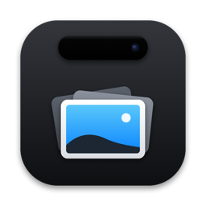

<p align="center">
  
</p>

<h1 align="center">Luoto</h1>

<p align="center">
  <b>Приложение для выреза, которое не мешает.</b><br>
  В покое: 0,0 % CPU. Играет музыка: 0,5 %. Указатель движется: 0,4 %.<br>
  Бесплатное, с открытым кодом, и молчит в сети, пока вы сами не попросите.
</p>

<p align="center">
  <a href="LICENSE"></a>
  
  
  <a href="README.md">English</a>
</p>

Luoto превращает вырез MacBook в небольшое место для буфера обмена, скриншотов и музыки. Это форк [Atoll](https://github.com/Ebullioscopic/Atoll).

Числа выше — средняя загрузка процессора процессом Luoto по `top` на MacBook. Покой значит, что на Маке никто не трогает клавиатуру и мышь; набор текста в других приложениях не мерился. В цифру с музыкой не входит небольшой помощник (процесс `perl`), который читает «Что сейчас играет» и работает только во время звука. Чтобы измерить самому, запустите Luoto и выполните [`scripts/perf/measure.sh`](scripts/perf/measure.sh) с меткой (`idle`, `music`, `mouse`) и длительностью в секундах (не больше 3 минут):

```bash
scripts/perf/measure.sh idle 120
```

## Что умеет

**Скриншоты пачками.** Делайте скриншоты как обычно (⇧⌘3, ⇧⌘4, ⇧⌘5). Они собираются в одну пачку у выреза. **Paste into Claude · 3** (или любое приложение, в котором вы работали) вставляет всю пачку. Можно выбрать, какие снимки уйдут, перетащить пачку куда угодно, разметить снимок или отправить по AirDrop. По желанию в пачку попадают и снимки сразу в буфер (⌃⇧⌘3/4). Они лежат во временной папке и удаляются в течение суток.

**История буфера обмена.** Всё, что вы копируете, становится карточкой, с поиском, фильтрами и закреплением. Вставить снова — одним кликом.

**Что сейчас играет.** Обложка, название и кнопки управления из Spotify, Music или вкладки браузера. Shuffle, повтор, громкость, вывод и текст песни появляются, пока указатель над плеером. **Next** показывает ближайшие события рядом. Короткое видео (до 5 минут) без сведений о треке плеер не перехватывает. Смахните закрытый вырез, чтобы сменить трек.

**Ещё в вырезе**
- Индикаторы громкости, яркости и подсветки клавиатуры вместо системных.
- События календаря и напоминания; таймер и Keep Awake с отсчётом времени.
- Полка для файлов, которые вы бросаете на вырез; отправка через AirDrop и LocalSend.
- Пипетка, которая копирует цвет, вкладка заметок (с синхронизацией с Apple Notes по желанию), терминал.
- Индикаторы Caps Lock, фокусов, записи экрана, использования микрофона и камеры, загрузок, подключений и заряда Bluetooth.
- Виджеты экрана блокировки: музыка, погода, событие календаря, напоминания, таймер, фокус.
- Громкость по приложениям и живая волна музыки.
- Статистика (CPU, память, диск, сеть, GPU) и монитор расхода Claude, Codex и Cursor.
- Screen Assistant: выделите часть экрана и спросите о ней ИИ-сервис.
- Расширения сторонних авторов, компактный вид, горячие клавиши, русский и английский.
- Пока экран показывают или записывают, буфер и скриншоты видны только заголовками.

Почти всё включается и выключается в настройках.

## Установка

Требования: **macOS 14.6+, проверено на 26.** Mac с Apple silicon (M1 и новее). Сделано для MacBook с вырезом; на других экранах Luoto показывает плавающий остров (проверено только на MacBook Pro с вырезом).

1. Скачайте `Luoto-<версия>.dmg` и `Luoto-<версия>.dmg.sha256` со страницы [Releases](../../releases).
2. Проверьте загрузку. Выполните в папке с обоими файлами; должно напечатать `OK`:
   ```bash
   shasum -a 256 -c Luoto-<версия>.dmg.sha256
   ```
3. Откройте DMG и перетащите **Luoto** в «Программы».
4. Откройте Luoto. macOS откажется запускать его в первый раз (см. ниже).
5. Пройдите знакомство. Оно задаёт один вопрос про сеть (обновления) и предлагает Accessibility; от обоих можно отказаться.

### Первый запуск: «Всё равно открыть»

Luoto **не нотаризован**. Нотаризация требует платного аккаунта разработчика Apple, а Luoto бесплатный. Поэтому macOS пишет, что не может проверить приложение, и блокирует его при первом запуске. Это один раз для каждой скачанной копии. Чтобы открыть:

1. Попробуйте открыть Luoto и закройте предупреждение.
2. Откройте **Системные настройки → Конфиденциальность и безопасность** и прокрутите до раздела «Безопасность».
3. Найдите строку про Luoto и нажмите **«Всё равно открыть»** (Open Anyway).
4. macOS может попросить пароль или Touch ID. Подтвердите и нажмите **«Открыть»** в следующем окне.

Скачивайте Luoto только со страницы Releases этого репозитория и сверяйте SHA-256.

## Разрешения

**При запуске Luoto ни о чём не просит.** Разрешение запрашивается, когда вы включаете нужную функцию или впервые ею пользуетесь. История буфера и пачки скриншотов работают с первого запуска; папка скриншотов открывается, когда вы нажимаете «Продолжить» в знакомстве при включённых скриншотах или открываете вкладку скриншотов. Откажете — эта функция молчит, остальное работает.

| Разрешение | Зачем | Когда Luoto просит | Без него |
|---|---|---|---|
| Accessibility (универсальный доступ; ключа нет, диалог самого macOS) | Нажимать ⌘V за вас для вставки в один клик; заменять системные индикаторы громкости, яркости и подсветки | Первая вставка в один клик (один раз), кнопка «Allow Access» в знакомстве или настройках | Вставка только копирует, Luoto говорит «нажмите ⌘V». Системные индикаторы остаются как есть |
| Автоматизация: Spotify, Music | Показывать плеер и управлять им | Первый клик по кнопке плеера или выбор источника | Нет управления плеером этого приложения |
| Автоматизация: Notes | Синхронизация заметок с Apple Notes | Когда вы включаете синхронизацию заметок | Синхронизация сообщает об ошибке; локальные заметки не страдают |
| Автоматизация: System Events | Остановить запись экрана кнопкой Stop | Первый клик по Stop | Luoto пробует другие способы остановки и сообщает, если не вышло |
| Bluetooth | Заряд Bluetooth-наушников | Когда вы включаете переключатель заряда Bluetooth (Устройства или экран блокировки) | Всплывает название устройства, без заряда |
| Календари | Ближайшие события в острове и на экране блокировки | Кнопка «Allow Access» в острове или переключатель события календаря на экране блокировки | Событий нет |
| Напоминания | Напоминания в острове и на экране блокировки | Та же кнопка или переключатели напоминаний | Напоминаний нет |
| Папка «Рабочий стол» | Смотреть папку скриншотов (по умолчанию Рабочий стол) и собирать новые снимки | «Продолжить» в знакомстве при включённых скриншотах или вкладка скриншотов | Снимки сразу в буфер собираются; снимки в папку — нет |
| Папка «Документы» | То же, только если папка скриншотов в «Документах» | В тот же момент, для этой папки | То же |
| Папка «Загрузки» | Показывать идущие загрузки | Когда вы включаете определение загрузок | Нет индикатора загрузок |
| Геолокация | Погода на экране блокировки | Когда вы включаете виджет погоды | Погода без точных координат |
| Apple Music | Анимированная обложка на экране блокировки | Когда вы включаете анимированную обложку | Нет анимированной обложки |
| Захват звука | Живая волна и громкость по приложениям. Звук обрабатывается на лету и нигде не записывается и не сохраняется | Когда вы включаете волну или меняете громкость приложения в первый раз | Нет волны; у громкости по приложениям появляется пояснение |
| Запись экрана | Screen Assistant: выделить часть экрана | Когда вы нажимаете кнопку выделения | Выделение ничего не делает |
| Локальная сеть | Находить устройства рядом для LocalSend | Когда вы включаете LocalSend | LocalSend не работает |
| Полный доступ к диску (по желанию; ключа и диалога нет) | Читать названия своих фокусов | Никогда; вы добавляете Luoto вручную в «Конфиденциальность и безопасность» | Фокус виден, но под названием «Focus» |
| Элементы связки ключей других приложений | Монитор расхода читает токены входа Claude, Codex, Cursor и др., чтобы спросить их расход | Когда вы включаете монитор расхода; macOS спрашивает про каждый элемент | Цифр расхода нет |
| Объекты входа (диалога нет) | Запускать Luoto при входе | Когда вы включаете автозапуск в Настройки → Основные | Luoto не запускается при входе |

Сбросить все разрешения можно в любой момент:

```bash
tccutil reset All io.github.amidamaru940.luoto
```

## Сеть

**По умолчанию в сеть ничего не уходит.** В Luoto нет аналитики.

**Обновления.** Знакомство спрашивает один раз, двумя равными кнопками: *Check once a day* и *Don't check*. До нажатия ничего не отправляется. После «да» Luoto раз в сутки делает один запрос к GitHub, который видит ваш IP-адрес и версию Luoto. Профиль системы не отправляется, ничего не ставится без вас. *Check for Updates…* в настройках работает в любой момент. Выбор можно изменить в настройках.

**Функции, которым нужна сеть, только когда вы их включили**

| Функция | Что уходит с вашего Mac и куда |
|---|---|
| Погода на экране блокировки | примерное местоположение или ваш IP-адрес → wttr.in, open-meteo.com |
| Обложки Spotify и YouTube Music | когда вы разрешите Luoto управлять Spotify (Automation) или выберете источником YouTube Music, обложка скачивается с адреса, который даёт плеер. Этот сервер видит ваш IP-адрес. Отдельного переключателя нет |
| Тексты песен | название трека и исполнитель → lrclib.net, music.163.com |
| Значки explicit и имена исполнителей | название и исполнитель → itunes.apple.com; id трека → open.spotify.com |
| Анимированная обложка Apple Music | запрос каталога → api.music.apple.com |
| Лайк и Canvas в Spotify | ваш вход в Spotify → accounts.spotify.com, api.spotify.com и связанные адреса Spotify, а также файл стороннего проекта raw.githubusercontent.com/xyloflake/spot-secrets-go |
| Screen Assistant | **снимки экрана и текст** → выбранный вами ИИ-сервис (Gemini, OpenAI, Groq, Anthropic) или локальный Ollama на этом Mac |
| Монитор расхода (Claude, Codex, Cursor, Antigravity) | токены из вашей связки ключей → эти сервисы; цены моделей с raw.githubusercontent.com |
| LocalSend | пока включён, слушает **локальную сеть** (TCP 53317 и multicast), а не только 127.0.0.1 |
| Расширения | порт на 127.0.0.1 для других приложений на этом Mac |

Управление Cider и YouTube Music говорит с этими плеерами на этом Mac (localhost). Обложки — исключение, оно указано в таблице.

Каждый адрес из исходников есть в [`tests/network_allowlist.txt`](tests/network_allowlist.txt) вместе с функцией и настройкой, которая его включает. Тест [`tests/test_network_allowlist.py`](tests/test_network_allowlist.py) падает, если появился адрес без записи. Адреса обложек приходят от плееров во время работы, поэтому их в этом списке нет. Запуск: `python3 -m unittest discover tests -p test_network_allowlist.py`.

## Приватность

- История буфера хранится только в памяти, пока вы не включите сохранение на диск.
- Пометки «скрытое» (так делают менеджеры паролей) и копии из исключённых приложений никогда не записываются.
- По умолчанию незакреплённые записи стираются через 24 часа (это можно изменить в настройках), одноразовые коды — через 2 минуты.
- Скриншоты в буфер лежат файлами во временной папке и удаляются в течение суток.

## Вопросы и ответы

**Почему «Всё равно открыть»?** Luoto не нотаризован: для этого нужен платный аккаунт Apple. Приложение подписано, исходники здесь, а SHA-256 позволяет проверить загрузку. См. [SECURITY.md](SECURITY.md).

**Зачем Accessibility?** Чтобы нажимать ⌘V в приложении, где вы работали (вставка в один клик), и ловить клавиши громкости и яркости для собственных индикаторов Luoto. Этот же доступ позволяет Luoto читать немного из других приложений: где стоят названия меню активного приложения (чтобы остров поместился рядом), открыто ли окно на весь экран, таймер «Часов» в строке меню и меню Tidal, если Tidal выбран источником. С этим доступом Luoto не читает содержимое экрана и не записывает набираемый текст. В простое проверка буфера ждёт следующего нажатия или движения указателя и не смотрит, какая это была клавиша. Без него вставка копирует, а ⌘V вы нажимаете сами.

**Съедает ли он батарею?** Смотрите числа в начале и измерьте на своём Mac через `scripts/perf/measure.sh`. Волна, громкость по приложениям, статистика, определение загрузок и монитор расхода работают только когда вы их включили.

**Сохранятся ли разрешения после обновления?** Должны. Каждый выпуск подписан одним и тем же сертификатом, и macOS считает новую версию тем же приложением; при переходе между двумя версиями с такой подписью Универсальный доступ сохранился. Если macOS всё же потеряет Accessibility, в настройках появится карточка **Restore Access**.

**Как удалить полностью?**
1. Выключите автозапуск в Настройки → Основные, если он включён.
2. Сбросьте разрешения: `tccutil reset All io.github.amidamaru940.luoto`
3. Закройте Luoto и удалите:
   - `/Applications/Luoto.app`
   - `~/Library/Preferences/io.github.amidamaru940.luoto.plist`
   - `~/Library/Application Support/io.github.amidamaru940.luoto`
   - `~/Library/Caches/io.github.amidamaru940.luoto`
   - `~/Library/HTTPStorages/io.github.amidamaru940.luoto` и `~/Library/HTTPStorages/io.github.amidamaru940.luoto.binarycookies`
   - `~/Library/Saved Application State/io.github.amidamaru940.luoto.savedState`
   - временную папку `Luoto clipboard screenshots` внутри `$TMPDIR` (`open "$TMPDIR"` покажет её)
4. Если вы входили в Spotify или Cider либо вводили API-ключи, откройте «Связку ключей», найдите `luoto` и `Atoll` и удалите найденное. Записи Spotify, Cider и монитора расхода носят имя приложения, от которого отделился Luoto.

**Чем отличается от Atoll?** Luoto — форк Atoll на одном коммите (см. [NOTICE](NOTICE)). Изменено: при запуске ни одно разрешение не запрашивается; каждая сетевая функция по умолчанию выключена и перечислена в тесте; обновления только если вы сказали «да», и только из релизов этого проекта; история буфера по умолчанию в памяти; пачки скриншотов. Убрано: всё, что было в сборке без известного источника или лицензии (видео AirPods и Beats, idle-анимации, часть звуков и картинок), зеркало камеры и старые каналы обновлений. Логотипы сервисов остались, это товарные знаки их владельцев: см. [TRADEMARKS](TRADEMARKS).

**А boring.notch и Droppy?** Atoll вырос из boring.notch, и Luoto тоже. Здесь Luoto не сравнивается с Droppy, и чужие приложения не измеряются.

## Сборка из исходников

Нужен Xcode. Если он попросит Metal Toolchain, один раз выполните `xcodebuild -downloadComponent MetalToolchain`.

```bash
git clone https://github.com/amidamaru940/luoto.git
cd luoto
open DynamicIsland.xcodeproj   # схема "DynamicIsland", нажмите Run
```

По умолчанию приложение подписано так, чтобы работать только на вашем Mac. Чтобы подписать его командой вашего (бесплатного) Apple ID и чтобы macOS помнила разрешения между пересборками, создайте `Config/Local.xcconfig` (git его игнорирует):

```
DEVELOPMENT_TEAM = ABCDE12345
CODE_SIGN_IDENTITY = Apple Development
```

- **DMG выпуска:** `scripts/make-release.sh` собирает DMG только средствами Xcode и macOS. Без ключей выпуска проекта он подписывает ad hoc, поэтому обновление вашей сборки не сохранит разрешения.
- **Тесты:** `xcodebuild test -scheme DynamicIsland -destination 'platform=macOS'` и `python3 -m unittest discover tests`. Тесты не обращаются к сети и не трогают ваши настоящие настройки.

## Авторы и лицензия

Luoto — форк [**Atoll**](https://github.com/Ebullioscopic/Atoll) (Ebullioscopic и соавторы), который вырос из [**boring.notch**](https://github.com/TheBoredTeam/boring.notch). Спасибо за основу. Сторонние пакеты и их лицензии — в [THIRD-PARTY-LICENSES.md](THIRD-PARTY-LICENSES.md).

Luoto — независимый проект, не связан с Apple и проектом Atoll. См. [NOTICE](NOTICE) и [TRADEMARKS](TRADEMARKS).

GPL-3.0-or-later: [GNU General Public License v3.0](LICENSE), как у Atoll и boring.notch. Исходники — этот репозиторий. О уязвимостях сообщайте приватно: [SECURITY.md](SECURITY.md).
